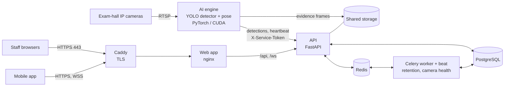

# ClassroomGuard

**AI-assisted exam-hall monitoring.** ClassroomGuard watches classroom CCTV cameras, detects
students using a **mobile phone** or an unpermitted **calculator**, and alerts invigilators in
real time with an annotated evidence frame. Staff review and act on alerts from a web dashboard
or a mobile app.

[](https://github.com/vishwa-10147/ClassroomGuard/actions/workflows/ci.yml)

> **Installing it on a college server?** Follow **[SETUP.md](SETUP.md)**.
> The operations guide for IT departments is [docs/DEPLOY_ONPREM.md](docs/DEPLOY_ONPREM.md).

ClassroomGuard supports invigilators. It does not replace them. Every alert is a prompt for a
person to check, never proof on its own (see [Detection accuracy](#detection-accuracy)).

---

## Contents

- [How it works](#how-it-works)
- [Features](#features)
- [Architecture](#architecture)
- [Technology stack](#technology-stack)
- [Project structure](#project-structure)
- [Prerequisites](#prerequisites)
- [Installation](#installation)
- [Configuration](#configuration)
- [Database and migrations](#database-and-migrations)
- [Running locally](#running-locally)
- [Running in production](#running-in-production)
- [API](#api)
- [Testing](#testing)
- [Linting and type checking](#linting-and-type-checking)
- [CI/CD](#cicd)
- [Deployment](#deployment)
- [Detection accuracy](#detection-accuracy)
- [Troubleshooting](#troubleshooting)
- [Security](#security)
- [Known limitations](#known-limitations)
- [Documentation](#documentation)
- [Contributing](#contributing)
- [License](#license)
- [Author](#author)

## How it works

1. **Detect.** A detector trained for exam halls finds phones and calculators in each camera
   frame (1280 px, CUDA FP16). A pose model finds every person and their wrists.
2. **Associate.** Each object is assigned to the nearest tracked person. An object within reach
   of a wrist is *in hand*; otherwise it is *at the desk*.
3. **Confirm.** The object must stay with that person for a set time (1 s for a phone, 1.5 s for
   a calculator), which filters out single-frame false alarms. Repeat alerts for the same
   person or desk are suppressed for 2 minutes.
4. **Alert.** The AI engine sends the detection to the API. It appears at once on every open
   dashboard: **HIGH** for in-hand use, **MEDIUM** for possession, with the evidence frame.
   Invigilators acknowledge, resolve or escalate it to an incident.

## Features

| Area | Capabilities |
|---|---|
| **Detection** | Phone and calculator detection; per-person association; in-hand vs. at-desk severity; calculator rule switchable per exam |
| **Real-time monitoring** | Alerts, detection events and dashboard figures update over WebSocket without reloading; AI engine and camera status reported every 30 s; cameras marked offline when they stop reporting |
| **Investigation** | Detection events with evidence frames, search and filters; alerts (acknowledge, assign, resolve, escalate to an incident); incidents with notes, assignment and escalation; live camera view when a stream URL is configured |
| **Recordings** | Upload exam footage for AI analysis with the same rules as live cameras; live progress and cancel; detections listed with their time in the video |
| **Seats and zones** | Draw seat zones on each camera so detections name the seat; ignore zones keep invigilators and aisles from being flagged |
| **Reporting** | Period and classroom summaries with a daily breakdown; CSV and PDF export |
| **Administration** | Users and five built-in roles; permission matrix; audit log; system settings; webhooks (Slack, Microsoft Teams, custom) |
| **Accounts** | Email password reset; automatic session renewal; rate-limited sign-in; accounts created by administrators |
| **Compliance** | Evidence retention enforced nightly; consent records; personal-data export and erasure endpoints |
| **Operations** | One-command installer, HTTPS, backup and restore, update script, health checks, optional Prometheus and Grafana |
| **Mobile** | Expo (React Native) app with alerts, cameras and push notifications |

## Architecture



The API is the only component that talks to the database. The AI engine is stateless apart from
its model files and can run on the same server or on separate GPU machines. Details, sequence
diagrams and the data model: [docs/ARCHITECTURE.md](docs/ARCHITECTURE.md).

## Technology stack

| Component | Technology |
|---|---|
| Web app | React 18, TypeScript 5, Vite, Tailwind CSS, Zustand, Recharts, jsPDF; served by nginx |
| API | Python 3.12, FastAPI, SQLAlchemy 2 (async, asyncpg), Alembic, Pydantic 2, python-jose (JWT), slowapi |
| Background jobs | Celery worker and beat on Redis |
| Data | PostgreSQL 16, Redis 7 |
| AI engine | PyTorch (CUDA 12.6), Ultralytics YOLO26 detector, YOLOv8m-pose, ByteTrack, OpenCV |
| Mobile | Expo / React Native, Expo Router |
| Edge | Caddy 2.8 (on-premise HTTPS) |
| Delivery | Docker Compose; GitHub Actions (CI and AWS deploy) |
| Monitoring (optional) | Prometheus, Grafana |

## Project structure

```
ClassroomGuard/
├── src/                        Web app (React + TypeScript)
├── backend/                    FastAPI app, Celery tasks, Alembic migrations, API tests
│   ├── app/api/                REST routers
│   ├── app/core/               settings, security, permissions, database, WebSocket
│   ├── app/models/             SQLAlchemy models
│   ├── app/services/           alerting, email, integrations
│   ├── app/tasks/              Celery tasks and schedules
│   ├── alembic/                database migrations
│   └── tests/                  HTTP tests against a running API
├── ai/                         AI engine, training and evaluation scripts, rules tests
├── mobile/                     Expo mobile app
├── e2e/                        Playwright end-to-end tests
├── deploy/                     Caddy configuration and certificate folder
├── scripts/                    install, backup, restore, update; Windows dev launchers
├── monitoring/                 Prometheus and Grafana configuration
├── docs/                       Architecture, API, configuration, deployment, troubleshooting
├── docker-compose.yml          Full stack (profiles: ai, monitoring)
├── docker-compose.https.yml    On-premise HTTPS overlay (Caddy)
├── docker-compose.ai-host.yml  AI engine on a separate GPU machine
└── docker-compose.aws.yml      AWS overlay (RDS, ElastiCache, ECR images)
```

## Prerequisites

| Use | Requirements |
|---|---|
| Production (on-premise) | Ubuntu Server 22.04/24.04, Docker Engine with the Compose plugin; for the AI engine an NVIDIA GPU (8 GB+ VRAM), driver 535+ and the NVIDIA Container Toolkit |
| Development | Python 3.12 (`.python-version`), Node.js 22 (`.nvmrc`), Docker (for PostgreSQL and Redis), Git |
| AI engine development | Python 3.12 and an NVIDIA GPU with CUDA 12.x drivers (it falls back to CPU, which is too slow for live cameras) |
| Model files | `exam_detector.pt` and `yolov8m-pose.pt` in `ai/models/`. They are not stored in git and are supplied separately |

## Installation

### Production server (Linux)

```bash
sudo git clone https://github.com/vishwa-10147/ClassroomGuard.git /opt/classroomguard
cd /opt/classroomguard
sudo cp /path/to/exam_detector.pt /path/to/yolov8m-pose.pt ai/models/   # GPU server only
sudo ./scripts/install.sh
```

The installer generates secrets into `.env`, starts every service behind HTTPS and creates the
first super admin. The full walk-through, including certificates, email, cameras and the
pre-exam checklist, is in [SETUP.md](SETUP.md).

### Development machine

Linux and macOS:

```bash
git clone https://github.com/vishwa-10147/ClassroomGuard.git && cd ClassroomGuard
cp .env.example .env                       # then edit; see Configuration
python3.12 -m venv backend/.venv
backend/.venv/bin/pip install -r backend/requirements-dev.txt
npm install
```

Windows (PowerShell):

```powershell
git clone https://github.com/vishwa-10147/ClassroomGuard.git; cd ClassroomGuard
Copy-Item .env.example .env                # then edit; see Configuration
py -3.12 -m venv backend\.venv
backend\.venv\Scripts\pip install -r backend\requirements-dev.txt
npm install
```

macOS has no NVIDIA GPU support. Develop the web app and API there, and run the AI engine on a
Linux or Windows machine with an NVIDIA GPU. AI engine setup: [ai/README.md](ai/README.md#running).

## Configuration

All server settings come from environment variables, normally the `.env` file in the repository
root. [`.env.example`](.env.example) lists them with comments. The required values are:

| Variable | Purpose |
|---|---|
| `POSTGRES_PASSWORD` | Database password |
| `REDIS_PASSWORD` | Redis password (the bundled Redis refuses to start without it) |
| `JWT_SECRET` | Signs access tokens; 32+ random characters (the API refuses to start in production otherwise) |
| `AI_SERVICE_TOKEN` | Shared secret the AI engine uses to send detections |

Generate secrets with `openssl rand -hex 32`. Never commit `.env`. The installer creates it with
`chmod 600`, and `scripts/update.sh` adds secrets that newer releases require. With
`APP_ENV=production` or `staging`, the API also requires an `AI_SERVICE_TOKEN` of 32+ characters
and explicit, non-local `ALLOWED_ORIGINS`.

Every variable, the AI engine's `ai/config.yaml` and the mobile app's settings are described in
[docs/CONFIGURATION.md](docs/CONFIGURATION.md).

## Database and migrations

- PostgreSQL schema changes are managed by **Alembic** (`backend/alembic/versions/`).
- The backend container applies pending migrations on every start
  (`python -m backend.scripts.migrate`), so updates need no manual step.
- In development, run them yourself from the repository root:

  ```bash
  backend/.venv/bin/python -m backend.scripts.migrate
  ```

- New migration after changing a model:

  ```bash
  backend/.venv/bin/alembic -c backend/alembic.ini revision --autogenerate -m "describe the change"
  ```

- Demo accounts and sample data, **for development only**: `python -m backend.seed_users` and
  `python -m backend.seed_data`. Never run them on a production server.

## Running locally

```bash
docker compose up -d postgres redis                        # database and Redis (see SETUP.md for the Redis port)

export DATABASE_URL=postgresql+asyncpg://classroomguard:<POSTGRES_PASSWORD>@localhost:5432/classroomguard
export REDIS_URL=redis://:<REDIS_PASSWORD>@localhost:6379/0
export APP_ENV=development
backend/.venv/bin/python -m backend.scripts.migrate
backend/.venv/bin/python -m backend.seed_users              # demo accounts
backend/.venv/bin/uvicorn backend.app.main:app --reload --port 8000

npm run dev                                                 # web app on http://localhost:3000
```

On Windows, set variables with `$env:NAME = "value"` and use `backend\.venv\Scripts\...`;
`start.cmd` starts the API and web app together. The Vite dev server proxies `/api` and `/ws`
to port 8000. Interactive API documentation is at <http://localhost:8000/docs> when
`APP_ENV` is not `production`.

Step-by-step development setup, demo accounts and the AI engine: [SETUP.md → Development
setup](SETUP.md#5-development-setup).

## Running in production

The supported production setup is Docker Compose:

| Service | Role |
|---|---|
| `caddy` | HTTPS on ports 443/80 (on-premise overlay) |
| `frontend` | nginx serving the web app and proxying `/api` and `/ws` |
| `backend` | FastAPI; runs migrations on start |
| `celery-worker`, `celery-beat` | Background and scheduled jobs |
| `postgres`, `redis` | Data stores (or RDS and ElastiCache on AWS) |
| `ai` | GPU AI engine (profile `ai`) |
| `prometheus`, `grafana` | Optional (profile `monitoring`, bound to localhost) |

```bash
sudo docker compose up -d          # uses COMPOSE_FILE and COMPOSE_PROFILES from .env
sudo docker compose ps             # every service Up / healthy
```

Backups, updates, scaling to more cameras and the security checklist:
[docs/DEPLOY_ONPREM.md](docs/DEPLOY_ONPREM.md).

## API

- REST under `/api/v1`, JSON, bearer access tokens (`Authorization: Bearer <token>`).
- WebSocket at `/ws?token=<access token>` for live `alert` and `detection` messages.
- The AI engine authenticates with the `X-Service-Token` header.
- Every route is protected by a named permission, enforced from one catalogue in
  `backend/app/core/permissions.py`.

The endpoint reference (107 routes with their required permissions), the authentication flow
and the WebSocket protocol are in [docs/API.md](docs/API.md). The OpenAPI schema is served at
`/openapi.json` and `/docs` in development.

## Testing

| Suite | Location | Command | Needs |
|---|---|---|---|
| Backend API | `backend/tests` | `cd backend && TEST_BASE_URL=http://localhost:8000 python -m pytest tests/` | Running API with demo seed data and `RATE_LIMIT_ENABLED=false`; set `TEST_AI_SERVICE_TOKEN` to include the service-token test |
| AI rules | `ai/tests` | `python -m pytest ai/tests` | `numpy`, `pytest` |
| Web unit | `src/**/*.test.ts` | `npx jest src` | `npm install` |
| End-to-end | `e2e/` | `npx playwright test` | Running stack; see [SETUP.md](SETUP.md#running-the-tests) for variables |

Results at the v1.0.0 release, run locally: backend 122 passed; AI rules 11 passed;
web unit 4 passed; end-to-end 7 passed (including the live AI-detection test). CI runs all four
suites on every pull request to `main`.

## Linting and type checking

| Check | Command |
|---|---|
| Python lint | `ruff check backend/` |
| Python types | `mypy --config-file backend/pyproject.toml backend/app/ --ignore-missing-imports` (from the repository root) |
| Web lint | `npm run lint` (ESLint flat config in `eslint.config.js`, zero warnings allowed) |
| TypeScript types | `npx tsc --noEmit` (web), `cd mobile && npx tsc --noEmit` (mobile) |
| Pre-commit hooks | `pre-commit install` (configuration in `.pre-commit-config.yaml`) |

## CI/CD

| Workflow | Trigger | What it does |
|---|---|---|
| [`ci.yml`](.github/workflows/ci.yml) | Push and pull request to `main` | Python 3.12 and Node 22: ruff, mypy, `tsc`, production build; PostgreSQL service, migrations, seed, API tests, AI rules tests, Jest, Playwright; Docker builds of the backend, frontend and AI images |
| [`deploy.yml`](.github/workflows/deploy.yml) | Push to `main`, manual | Builds and pushes images to Amazon ECR and rolls them out on EC2 through SSM. Skipped until the `AWS_ROLE_ARN` repository variable is set |

## Deployment

| Target | Guide |
|---|---|
| **College server (on-premise)** | [SETUP.md](SETUP.md), then [docs/DEPLOY_ONPREM.md](docs/DEPLOY_ONPREM.md) |
| **AWS** | [docs/DEPLOY_AWS.md](docs/DEPLOY_AWS.md): EC2 GPU, RDS, ElastiCache, ECR, ALB with TLS |
| **Additional AI machine** | `docker compose -f docker-compose.ai-host.yml up -d` ([details](docs/DEPLOY_ONPREM.md#9-operations)) |

Operations scripts: `scripts/backup.sh`, `scripts/restore.sh`, `scripts/update.sh`.

## Detection accuracy

Measured on held-out data the model never saw during training, with thresholds fixed on
validation data beforehand. Method and full figures: [ai/README.md](ai/README.md#accuracy).

| Test set | Class | Precision | Recall | F1 |
|---|---|---|---|---|
| All test images (387) | Mobile phone | 0.94 | 0.74 | 0.83 |
| All test images (387) | Calculator | 0.83 | 0.89 | 0.86 |
| Unseen CCTV classroom | Mobile phone | 0.93 | 0.43 | 0.59 |

These are per-frame figures. A phone in use usually stays visible for several frames, so it is
often caught even when one frame misses it. Precision is high, so false alarms are uncommon, but
**some phones will be missed**, particularly small ones at the back of large halls.

## Troubleshooting

| Symptom | First check |
|---|---|
| Browser certificate warning | Install the college certificate or trust the internal CA ([SETUP.md §3.1](SETUP.md#31-https-certificate)) |
| Header shows **AI Offline** | `sudo docker compose logs ai`, `nvidia-smi`, model files in `ai/models/` |
| Camera stays offline | `backend_camera_id` in `ai/config.yaml` must equal the Camera ID in the web app |
| No password-reset email | `SMTP_*` values in `.env`; `sudo docker compose logs backend` |

More symptoms and fixes: [docs/TROUBLESHOOTING.md](docs/TROUBLESHOOTING.md).

## Security

- HTTPS only on-premise (Caddy); only ports 80 and 443 are exposed; the API and the metrics
  endpoint are not published directly.
- Short-lived JWT access tokens with rotating, revocable refresh tokens stored hashed. Sign-in
  and password reset are rate limited, and reset links are single-use.
- Role-based access control on every endpoint. Only super admins can create or promote super
  admins. Public sign-up is disabled by default.
- The AI engine uses a dedicated service token. Live updates require a signed-in, active user
  and are delivered only to users of the same organisation.
- Uploaded file names are checked against path traversal; webhook URLs to private networks are
  refused.
- The API refuses to start in production with a weak `JWT_SECRET`. Containers run as non-root.
- Evidence frames are deleted automatically after the retention period set in System Settings.

### Production hardening checklist

Before exposing an installation to real users:

1. Copy `.env.example` to `.env`, generate unique secrets, and keep the file outside source
   control. Production requires `JWT_SECRET`, `AI_SERVICE_TOKEN`, `POSTGRES_PASSWORD` and
   `REDIS_PASSWORD`.
2. Set explicit HTTPS `FRONTEND_URL` and `ALLOWED_ORIGINS`. Never use localhost origins in
   staging or production.
3. Use the readiness endpoint (`/health/ready`) for load-balancer and container health checks.
   It returns `503` when PostgreSQL or Redis is unavailable.
4. Put Prometheus and Grafana on an administration-only network, set a unique Grafana password,
   and do not expose their ports publicly.
5. Use organisation-scoped accounts and verify cross-organisation access with the backend test
   suite before importing existing data. Legacy rows with a null `organization_id` need a
   migration or ownership decision before production use.
6. Rotate any credentials that may have existed in local `.env` or backup files, and remove real
   student evidence from source trees and deployment archives.

Report vulnerabilities privately as described in [SECURITY.md](SECURITY.md). ClassroomGuard
processes video of students. Colleges should inform students and staff and set a retention
period that matches their examination rules
([privacy guidance](docs/DEPLOY_ONPREM.md#11-privacy-and-policy)).

## Known limitations

- **Accuracy:** some phones are missed (see [Detection accuracy](#detection-accuracy)).
  Calculator detection has been validated on photographs, not yet on CCTV footage.
- **Who is who:** detections name a seat only where seat zones have been drawn for the camera,
  and never a named student. Invigilators are only excluded inside ignore zones; one walking
  between rows is tracked like a student.
- **Recordings:** analysis needs the `ai-recordings` worker running on a GPU machine. Uploads are
  limited to 500 MB per file.
- **Head-turn and looking-down cues** are implemented but disabled by default. On overhead
  cameras they fire on normal exam behaviour and need per-camera calibration.
- **Mobile app:** push notifications need the college's Expo (EAS) project ID at build time
  (`EAS_PROJECT_ID`, see [Configuration](docs/CONFIGURATION.md#mobile-app-mobileenv)).
- **Observability:** Sentry and OpenTelemetry are off unless `SENTRY_DSN` or `ENABLE_TRACING`
  is set (see [Configuration](docs/CONFIGURATION.md#observability)). No collector or Sentry
  server is bundled. `/metrics` (Prometheus, internal network only) records request metrics.
- **Webhooks** reach public addresses only, unless the private networks of a campus receiver
  are listed in `WEBHOOK_ALLOWED_NETWORKS`. Loopback and link-local addresses are always refused
  to prevent server-side request forgery.
- The largest accuracy gain will come from retraining with labelled footage from the college's
  own halls ([ai/README.md → Improving the model](ai/README.md#improving-the-model)).

## Documentation

| Document | Contents |
|---|---|
| [SETUP.md](SETUP.md) | Installation, first-time configuration, verification, development setup |
| [docs/ARCHITECTURE.md](docs/ARCHITECTURE.md) | Components, data flow, detection pipeline, data model |
| [docs/CONFIGURATION.md](docs/CONFIGURATION.md) | Every environment variable and the AI engine configuration |
| [docs/API.md](docs/API.md) | Authentication, WebSocket protocol, endpoint reference |
| [docs/DEPLOY_ONPREM.md](docs/DEPLOY_ONPREM.md) | On-premise operations, backups, security checklist, privacy |
| [docs/DEPLOY_AWS.md](docs/DEPLOY_AWS.md) | AWS deployment |
| [docs/TROUBLESHOOTING.md](docs/TROUBLESHOOTING.md) | Symptoms and fixes |
| [ai/README.md](ai/README.md) | AI engine, accuracy, retraining |
| [ai/training/README.md](ai/training/README.md) | Training data, settings and evaluation protocol |
| [CONTRIBUTING.md](CONTRIBUTING.md) | Development workflow and conventions |
| [SECURITY.md](SECURITY.md) | Reporting vulnerabilities and deployment hardening |
| [CHANGELOG.md](CHANGELOG.md) | Release history |

## Contributing

Contributions are welcome through pull requests to `main`. Read [CONTRIBUTING.md](CONTRIBUTING.md)
for the branch, test and commit conventions.

## License

No open-source license has been chosen yet. Until a `LICENSE` file is added, all rights are
reserved by the author, and the code may not be copied, modified or redistributed without
permission.

## Author

Developed by **[vishwa-10147](https://github.com/vishwa-10147)**.
