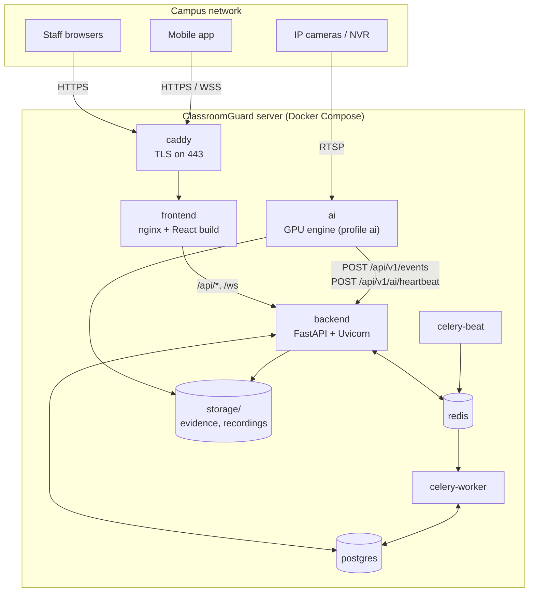
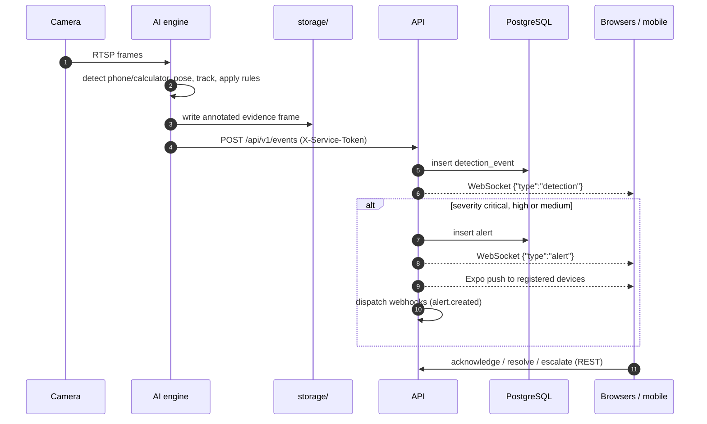
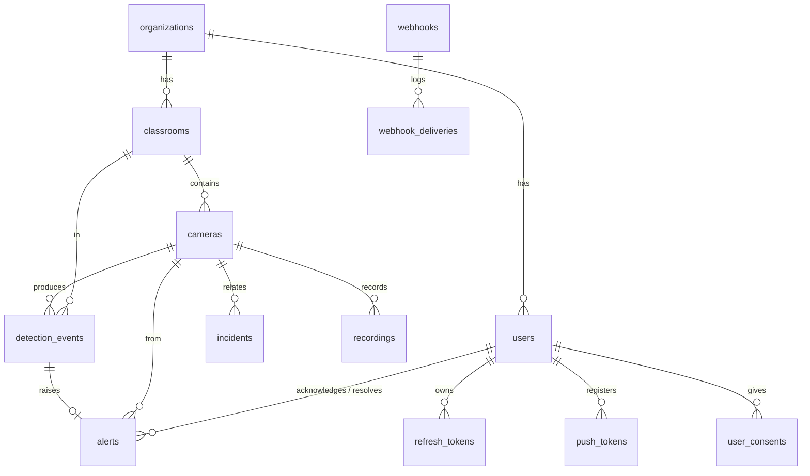

# Architecture

This document describes how ClassroomGuard is put together: the components, how a detection
travels from a camera to an invigilator's screen, the data model and the security model.
For installation see [SETUP.md](../SETUP.md); for the endpoint reference see [API.md](API.md).

## Components

| Component | Source | Responsibility |
|---|---|---|
| Web app | `src/` | React single-page app. Talks only to `/api/v1` and `/ws`, through nginx |
| nginx | `nginx.conf`, `Dockerfile` | Serves the built app, proxies `/api/` and `/ws` to the backend, adds security headers, `/healthz` for load balancers |
| Caddy | `deploy/caddy/Caddyfile` | HTTPS termination on-premise (internal CA, college certificate or Let's Encrypt); redirects HTTP to HTTPS |
| API | `backend/app/` | REST API, WebSocket hub, authentication and RBAC, alert creation and fan-out, reports |
| Celery worker and beat | `backend/app/core/celery.py`, `backend/app/tasks/` | Scheduled and background jobs (see [Background jobs](#background-jobs)) |
| PostgreSQL | `postgres:16-alpine` | System of record |
| Redis | `redis:7-alpine` | Celery broker and result backend |
| AI engine | `ai/` | Reads camera streams, runs detection, pose and tracking, applies exam rules, posts detections and heartbeats |
| Mobile app | `mobile/` | Expo app for alerts and cameras, with push notifications |

The API is the only component with database access. The AI engine holds no state that must
survive a restart; it needs only its configuration, model files and access to the shared
`storage/` folder.

## From camera frame to alert

### Detection pipeline (AI engine)

| Stage | Implementation |
|---|---|
| Capture | `ai/src/camera_manager.py`: one reader per camera, RTSP reconnect, drops corrupt grey frames, measures the processing rate |
| Object detection | YOLO26s fine-tuned for `cell_phone` and `calculator` (`ai/models/exam_detector.pt`), 1280 px input, FP16 on CUDA, per-class thresholds from the evaluation report |
| People | YOLOv8m-pose for person boxes and wrist keypoints |
| Tracking | ByteTrack, per camera |
| Association | Each object goes to the nearest person; within reach of a wrist = *in hand* (HIGH), otherwise *at desk* (MEDIUM) |
| Confirmation | Time-based persistence: 1 s for a phone, 1.5 s for a calculator |
| De-duplication | `alerts.object_cooldown` (default 120 s) per person or desk location |
| Reporting | `ai/src/alert_system.py`: event POST with evidence path; heartbeat every 30 s with per-camera status and FPS |

Posture cues (head turn, looking down) are implemented but disabled by default. Accuracy and
training details are in [ai/README.md](../ai/README.md).

### Real-time delivery

- Clients connect to `/ws?token=<access token>`. The API accepts the connection only for an
  active user, checks the `Origin` header against `ALLOWED_ORIGINS`, and tags the connection with
  the user's organisation (`backend/app/core/websocket.py`).
- Broadcasts are published on a Redis pub/sub channel, and every API process relays them to its
  own connections, so more than one API container can run behind the proxy. Without Redis
  (`USE_REDIS=false`) the API falls back to an in-process broadcast, which only works with a
  single API process.
- Messages carrying an organisation are delivered only to connections of that organisation.
- Rate-limit counters are kept in memory by each API process, so with several API containers the
  effective limit is multiplied by their number.
- The web app's `RealTimeProvider` turns `alert` and `detection` messages into refresh ticks.
  Pages subscribe with `useLiveRefresh`, so lists and dashboard figures refresh without a reload.

### Camera and engine health

- Each AI engine posts `/api/v1/ai/heartbeat` every 30 s. The API updates the status, FPS and
  `ai_processing` fields of every camera listed, and records the engine for `/api/v1/status`.
- `celery-beat` runs `scheduled_mark_stale_cameras_offline` every 60 s. Cameras that have not
  reported for 120 s are marked offline.
- The web app header shows **AI Online** when at least one engine reported in the last 90 s.

## Background jobs

| Job | Schedule | Purpose |
|---|---|---|
| `scheduled_retention_enforcement` | Daily 02:00 | Applies the data-retention period from System Settings |
| `scheduled_cleanup_old_evidence` | Daily 03:00 | Deletes evidence frames older than the retention period |
| `scheduled_mark_stale_cameras_offline` | Every 60 s | Marks silent cameras offline |

Workers use `DB_NULL_POOL=true` so that database connections are not shared across event loops.

## Data model

Other tables: `roles` (custom role permissions), `system_settings` (key/value settings such as
the retention period), `audit_logs`, `compliance_logs` and `retention_policies`. The schema is
managed by Alembic (`backend/alembic/versions/`). The backend applies migrations when it starts.

## Security model

| Concern | Mechanism | Code |
|---|---|---|
| Staff authentication | Email and password (bcrypt), JWT access token (`ACCESS_TOKEN_EXPIRE_MINUTES`), rotating refresh token stored hashed, revoked on logout | `backend/app/api/auth.py`, `backend/app/core/security.py` |
| Authorisation | Named permissions per route; roles map to permissions | `backend/app/core/permissions.py`, `backend/app/api/dependencies.py` |
| AI engine | Shared `AI_SERVICE_TOKEN` in the `X-Service-Token` header, accepted only on ingestion routes | `require_permission_or_service` |
| Account creation | Administrators create accounts; public sign-up is off unless `ALLOW_SELF_REGISTRATION=true` | `backend/app/api/users.py`, `auth.py` |
| Brute force | `slowapi` limits sign-in, forgot-password and reset to 5 per minute per client | `backend/app/core/rate_limit.py` |
| Transport | Caddy TLS with HSTS; the API and `/metrics` are not published outside the Docker network | `docker-compose.https.yml` |
| Headers | Content-Security-Policy, X-Frame-Options, nosniff and referrer policy in nginx; `SecurityHeadersMiddleware` in the API | `nginx.conf`, `backend/app/core/security_headers.py` |
| Production guard | The API refuses to start with a default or short `JWT_SECRET`, or with `DEBUG=true` | `backend/app/core/config.py` |

## Deployment topologies

| Topology | Files |
|---|---|
| Single on-premise server with GPU | `docker-compose.yml` + `docker-compose.https.yml`, `COMPOSE_PROFILES=ai` |
| Web server + separate AI machines | Main server as above without `ai`; each GPU machine runs `docker-compose.ai-host.yml` and shares `storage/` |
| AWS | `docker-compose.yml` + `docker-compose.aws.yml` on EC2, with RDS, ElastiCache, ECR and an ALB ([DEPLOY_AWS.md](DEPLOY_AWS.md)) |
